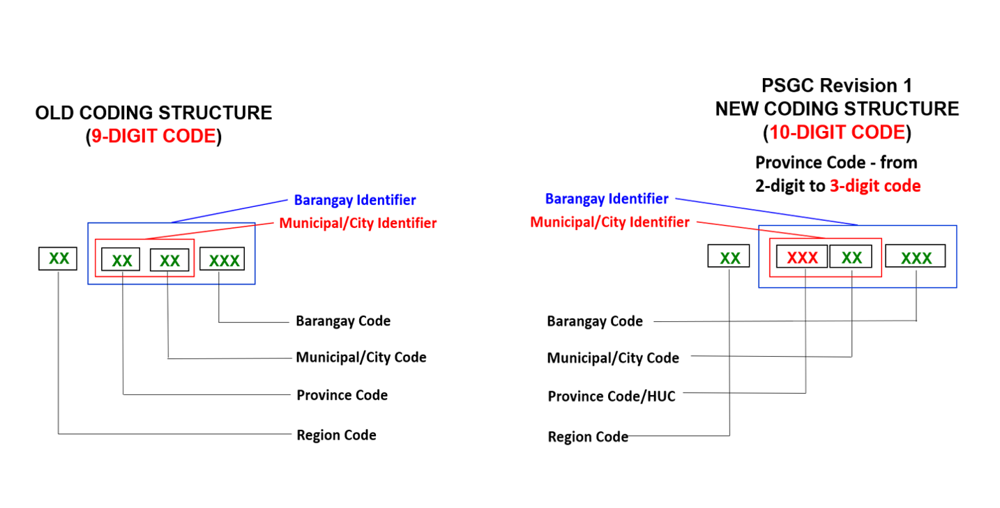

# Philippines PSGC Administrative Boundaries Shapefiles

Philippine administrative boundaries, from the whole country down to the barangay, with codes and
names matched to the Philippine Standard Geographic Code (PSGC) published by the Philippine
Statistics Authority (PSA). Every row carries its PSGC code and its parents' codes, so you can join
the maps directly to PSA statistics, or to any dataset keyed by PSGC.

The PSGC releases these files reflect are listed in the [Changelog](CHANGELOG.md).

## Download

Download the files from this repository's [Releases](https://github.com/faeldon/philippines-psgc-shapefiles/releases):
one release per PSGC quarter, the newest marked **Latest**. Each release holds every level's zipped
shapefile and CSV, and a `SHA256SUMS` file to check them against (`shasum -a 256 -c SHA256SUMS`).
The links below always point at the latest quarter. No `git-lfs` is needed.

The CSVs of the latest quarter are also in [`dist/`](dist/) in this repository. You only need to
clone it to run the pipeline (see [CLAUDE.md](CLAUDE.md)), which fetches its raw sources with
`python scripts/sources.py fetch`.

## Files

Each level comes as a zipped ESRI shapefile and as a CSV with the same attributes and no geometry.

| Level | Shapefile | CSV | One row per |
| --- | --- | --- | --- |
| 0 | [PH_Adm0_Country.shp.zip](https://github.com/faeldon/philippines-psgc-shapefiles/releases/latest/download/PH_Adm0_Country.shp.zip) | [PH_Adm0_Country.csv](dist/PH_Adm0_Country.csv) | Polygon of the country outline |
| 1 | [PH_Adm1_Regions.shp.zip](https://github.com/faeldon/philippines-psgc-shapefiles/releases/latest/download/PH_Adm1_Regions.shp.zip) | [PH_Adm1_Regions.csv](dist/PH_Adm1_Regions.csv) | Region |
| 2 | [PH_Adm2_ProvDists.shp.zip](https://github.com/faeldon/philippines-psgc-shapefiles/releases/latest/download/PH_Adm2_ProvDists.shp.zip) | [PH_Adm2_ProvDists.csv](dist/PH_Adm2_ProvDists.csv) | Province or NCR district |
| 3 | [PH_Adm3_MuniCities.shp.zip](https://github.com/faeldon/philippines-psgc-shapefiles/releases/latest/download/PH_Adm3_MuniCities.shp.zip) | [PH_Adm3_MuniCities.csv](dist/PH_Adm3_MuniCities.csv) | Municipality or city |
| 4 | [PH_Adm4_BgySubMuns.shp.zip](https://github.com/faeldon/philippines-psgc-shapefiles/releases/latest/download/PH_Adm4_BgySubMuns.shp.zip) | [PH_Adm4_BgySubMuns.csv](dist/PH_Adm4_BgySubMuns.csv) | Barangay or sub-municipality |
| 4, complete | [PH_Adm4_BgySubMuns_complete.shp.zip](https://github.com/faeldon/philippines-psgc-shapefiles/releases/latest/download/PH_Adm4_BgySubMuns_complete.shp.zip) | [complete/PH_Adm4_BgySubMuns.csv](dist/complete/PH_Adm4_BgySubMuns.csv) | The same, with the shapes no boundary describes approximated |

### Two distributions of level 4

Four barangays created in 2024 have no published boundary: Marawi's Sultan Corobong, Sultan
Panoroganan and Angoyao, and Tupi's Juan-Loreto Tamayo. The ordinances that created them aren't
published, so their boundaries are known only roughly. Level 4 therefore comes in two versions:

- **Known** (`PH_Adm4_BgySubMuns.*`) has only what is known. Those four barangays are rows without
  a shape (`geom_src` = `none`), and the barangays they were cut from keep their earlier, larger
  shapes.
- **Complete** (`PH_Adm4_BgySubMuns_complete.*`; its CSV is `dist/complete/` here) gives every
  barangay a shape. Each of the four is cut from its mother barangays
  by one straight line, sized to a target area: Tupi's to the reported 2,300 ha, on the side
  facing Mt. Matutum; Marawi's to their share of their mother's 2024 population, at the end
  farther from the city centre. These shapes are **indicative only**: `geom_src` = `approximated`
  marks them and the mothers they were cut from. Everything else is the same as known.

Levels 0–3 are the same for both: the four barangays sit inside their municipalities.

### Columns

| Column | Description |
| --- | --- |
| `adm1_psgc` … `adm4_psgc` | PSGC code of the area at that level. Each level has its own code and the codes of every level above it. |
| `adm0_en` … `adm4_en` | Name of the area, as PSA publishes it. |
| `geo_level` | PSA's geographic level, e.g. `Reg`, `Prov`, `Dist`, `City`, `Mun`, `SubMun`, `Bgy`. |
| `geom_src` | Level 4 only: where the shape comes from (below). |
| `len_crs`, `area_crs` | Perimeter in metres and area in square metres, in EPSG:32651. |
| `len_km`, `area_km2` | Perimeter in kilometres and area in square kilometres. |

`geom_src` is one of:

| Value | The shape |
| --- | --- |
| `source` | The boundary file's own shape (see Sources), or what's left of it once a `plotted` barangay is cut out of it (Barobo's Javier). |
| `dissolved` | The union of barangays PSA has merged. |
| `plotted` | Plotted from the bearings and distances of the law that created the barangay, and placed against the barangay it was cut from: Barobo's Guinhalinan (RA 11986) and Caloocan's 176-A to 176-F (RA 11993). The laws don't publish their survey monuments' coordinates, so the placement is fitted, and as accurate as the boundary file's own lines. |
| `approximated` | Complete only: an indicative shape, as above. |
| `none` | No shape. Manila's 14 sub-municipalities (their barangays hold the area), and in known the four barangays above. |

Each zip holds one layer, `PH_AdmN_*.shp`, whose attributes match the CSV row for row. Geometries
use EPSG:32651 (WGS 84 / UTM zone 51N), coordinates in metres. Corrections to files already
published are listed under [Data corrections](CHANGELOG.md#data-corrections).

## Conventions

PSGC codes follow PSA's 10-digit structure and are stored as numbers, so leading zeros are dropped
(Region I is `100000000`, not `0100000000`).

Parent codes are stored on every row so that tables join across levels without a lookup. For
example, `PH_Adm4_BgySubMuns.csv` joins to `PH_Adm3_MuniCities.csv` on `adm3_psgc`. A few areas
need a parent that PSA doesn't give them:

- **Cities that PSA places under no province** (highly urbanized and independent component
  cities) carry their geographic province, or their NCR district, as `adm2_psgc`.
- **Manila's sub-municipalities** and their barangays sit under the City of Manila.
- **BARMM's Special Geographic Area**: its eight municipalities (created in 2024) and their 63
  barangays sit under PSA's interim province code `1999900000`.

## Sources

The boundaries come from OCHA's [Philippines administrative level 0-4 boundaries
(COD-AB)](https://data.humdata.org/dataset/cod-ab-phl) on the Humanitarian Data Exchange, by the
National Mapping and Resource Information Authority (NAMRIA) and PSA, licensed
[CC BY-IGO](http://creativecommons.org/licenses/by/3.0/igo/legalcode). The files are its release of
November 6, 2023 (`phl_admbnda_admN_psa_namria_20231106`). OCHA's current files
(`phl_admin_boundaries.shp.zip`, May 28, 2026, version 3) have the same shapes in a new layout, and
still follow the PSGC of late 2023.

Their codes and names are matched to PSA's [PSGC publication datafiles](https://psa.gov.ph/classification/psgc),
and the geometry follows PSA's changes since: regions and municipalities whose members changed are
rebuilt from them (the Negros Island Region, Sulu's move to Region IX, BARMM's eight new
municipalities), merged barangays are dissolved, and divided barangays are plotted from the law that
divided them (`geom_src`, above). Each PSA publication is kept in `data/psgc/<id>/` as CSV extracts of
PSA's files, with their source URLs and checksums, and a report of what changed from the publication
before it, checked against PSA's own Summary of Changes. Every edit is in `data/edit/<date>/` and in
the release file it belongs to, `releases/<id>.toml`.

Earlier versions of this project used:

- **2023:** the same COD-AB release, matched to the PSGC of 4Q 2023.
- **2015:** OCHA's Level 0–3 shapefiles (no longer available) and the Level 4 shapefiles in
  [justinelliotmeyers/official_philippines_shapefile_data_2016](https://github.com/justinelliotmeyers/official_philippines_shapefile_data_2016).
- **2011:** the Level 0–4 shapefiles from [GADM](https://gadm.org).

## AI assistance

This repository is developed with AI coding assistance: Claude (Anthropic), through
[Claude Code](https://claude.com/claude-code). The maintainer reviews and approves every change,
and is responsible for what is published. The AI works under the rules in [CLAUDE.md](CLAUDE.md),
whose CONTRACTs every regenerated level must pass (one row per PSGC code, parent codes that exist,
counts checked against PSA's table), and through the change process in [.sdlc/SDLC.md](.sdlc/SDLC.md).
Files in `dist/` are replaced only after those checks pass and the maintainer approves that run.
Commits don't carry AI attribution lines; this section is the disclosure for the whole repository.

## Contributing

Contributions of any size are welcome. Please read the [contributing guide](.github/CONTRIBUTING.md)
and the [code of conduct](.github/CODE_OF_CONDUCT.md) first.

Found a wrong code, name or boundary? Please [file an issue](https://github.com/faeldon/philippines-psgc-shapefiles/issues).
